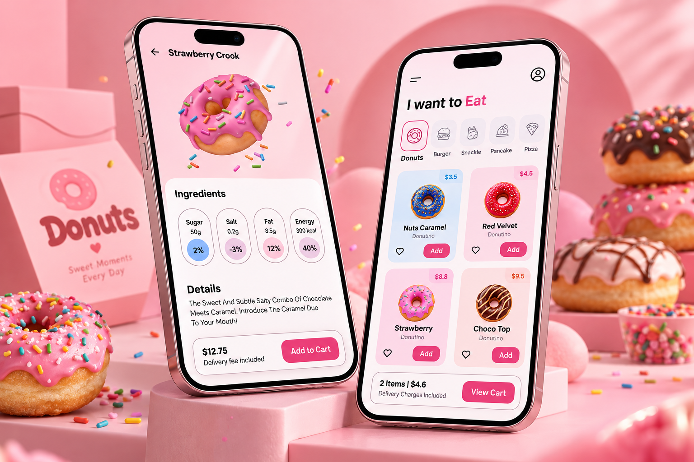

<div align="center">

# 🍩 Donuts UI Design App

### Flutter • Dart • Modern Food Ordering UI

A beautiful and modern donut shopping application
UI built with **Flutter and Dart**, featuring
colorful product cards, an elegant pink-themed
design, and a smooth shopping experience.


</div>

---

## 📸 Project Preview

<div align="center">

<a href="d60e1a95-0e68-4c1d-9fb1-06921755d447.png">
  
</a>

</div>

---

## 📖 About the Project

**Donuts UI Design App** is a Flutter mobile
application focused on creating a visually
appealing donut shopping experience.

The project showcases modern mobile UI design
principles, colorful food illustrations,
responsive layouts, and reusable Flutter widgets.

The interface is inspired by modern food
ordering applications, with an emphasis on
clean navigation and attractive product
presentation.

---

## ✨ UI Features

### 🍩 Donut Catalog

- Colorful donut product cards.
- Attractive food illustrations.
- Product names and pricing.
- Organized product layouts.
- Modern shopping interface.

### 🏠 Home Screen

- Clean and modern home layout.
- Featured donut products.
- Promotional banner design.
- Product browsing interface.
- Search bar design.

### 🍫 Product Details

- Large donut product images.
- Product descriptions.
- Price display.
- Quantity selection UI.
- Add to Cart button design.

### 🛒 Shopping Cart UI

- Shopping cart screen design.
- Product quantity controls.
- Order summary layout.
- Checkout button interface.

### ❤️ Favorites UI

- Favorite product icons.
- Wishlist-inspired design.
- Interactive shopping elements.

### 🎨 Modern UI/UX

- Pink and pastel color palette.
- Rounded product cards.
- Modern typography.
- Responsive Flutter layouts.
- Reusable UI components.
- Clean navigation design.

---

## 📱 Application Screens

| Screen | Description |
|--------|-------------|
| Welcome | Donut-themed onboarding design |
| Home | Featured products and donut catalog |
| Product Details | Product information and pricing |
| Favorites | Wishlist-inspired interface |
| Cart | Shopping cart and checkout UI |

---

## 🛠️ Technologies Used

| Technology | Purpose |
|------------|---------|
| Flutter | Cross-platform UI |
| Dart | Application development |
| Material Design | UI components |
| Flutter Widgets | Custom UI components |
| Git | Version control |
| GitHub | Source code hosting |

---

## 🏗️ Application Overview

```text
          Donuts UI Design App
                   |
                   v
             Flutter UI
                   |
          +--------+--------+
          |        |        |
          v        v        v
        Home    Products   Cart UI
                   |
                   v
             Product Details
                   |
                   v
             Shopping UI
```

---

## 🎨 Design Highlights

The application focuses on:

- Attractive donut illustrations.
- Soft pink and cream backgrounds.
- Consistent visual styling.
- Clean product presentation.
- Rounded cards and buttons.
- User-friendly navigation.
- Modern mobile design principles.

The goal is to create an enjoyable
and visually engaging food shopping
interface using Flutter.

---

## 📂 Project Structure

```text
Donuts-UI-Design-App/
│
├── android/
├── ios/
├── lib/
├── images/
│   └── donuts/
├── linux/
├── macos/
├── web/
├── windows/
├── test/
├── pubspec.yaml
└── README.md
```

The `images/donuts/` directory contains
the project's donut image assets.

---

## 🚀 Getting Started

### Prerequisites

Install:

- Flutter SDK
- Dart SDK
- Android Studio or VS Code
- Git

### 1. Clone the Repository

```bash
git clone https://github.com/AhmedJaberAhmed/Donuts-UI-Design-App.git
```

### 2. Navigate to the Project

```bash
cd Donuts-UI-Design-App
```

### 3. Install Dependencies

```bash
flutter pub get
```

### 4. Run the Application

```bash
flutter run
```

---

## 💡 Development Highlights

This project demonstrates experience in:

- Flutter UI development.
- Custom widget design.
- Responsive mobile layouts.
- Product card interfaces.
- Food application design.
- UI component organization.
- Working with local image assets.
- Modern Material Design principles.

---

## 🎯 Project Goals

- Practice modern Flutter UI development.
- Create a visually attractive food shopping app.
- Build reusable UI components.
- Improve responsive layout skills.
- Design engaging product interfaces.
- Showcase Flutter frontend development.

---

## 👨‍💻 Developer

**Ahmed Jaber Ahmed**

Flutter Developer | Mobile App Developer

B.Sc. Computer Science & Artificial Intelligence

📍 Cairo, Egypt

- [GitHub](https://github.com/AhmedJaberAhmed)
- [Portfolio](https://ahmedjaberahmed.github.io/Jaber-website/)
- [LinkedIn](https://www.linkedin.com/in/ahmedjaberahmed/)

---

<div align="center">

### ⭐ Support the Project

If you like this project,
consider giving it a star!

**Made with Flutter 💙**

</div>
